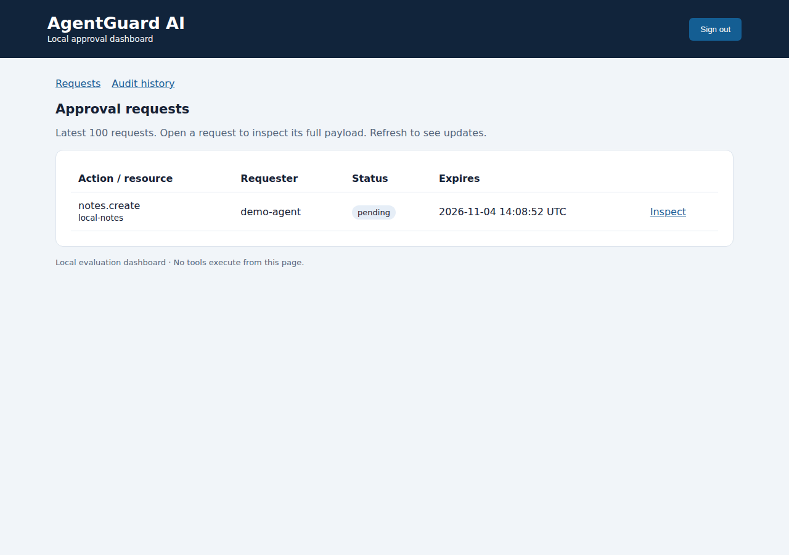

# AgentGuard AI

[](https://github.com/Maitraiy1/agentguard-ai/actions/workflows/ci.yml)
[](https://github.com/Maitraiy1/agentguard-ai/actions/workflows/security.yml)
[](LICENSE)

**Default-deny policy checks and human approvals for Python agent tools.**

An agent proposes an exact action. Your policy checks identity and parameters. A human
reviews sensitive actions in a local dashboard. A trusted adapter consumes the approval
once, executes the action and records the result.

Version **0.3.0** is an early **local evaluation toolkit**, not a sandbox or a public hosting
service. The host, tool adapters and configuration remain trusted. No independent security
audit, broad adoption or production guarantee is claimed.



[Watch the recorded Chromium walkthrough](docs/media/walkthrough.mp4) ·
[Audit screenshot](docs/media/audit.png) · [Changelog](CHANGELOG.md)

The recording is a real automated browser run, slowed five times for readability. Test-only
sample data is shown. Browser tests also verify that an approved note file is created and a
denied note is not. It is not a recording of a production deployment.

## What works

- Exact tool/resource/principal policies with deny > approval > allow precedence.
- Strict parameter types, destination allowlists, extra-key rejection and size/range limits.
- Immutable action snapshots and SHA-256 fingerprints binding approvals to exact payloads.
- Expiring single-use approvals, reviewer allowlists and self-approval prevention.
- Reviewer revocation and durable policy generations: old approvals stay invalid after rollback.
- Password-authenticated local dashboard, request inspection and audit history.
- A useful create-only text-note adapter that refuses traversal, device names and overwrites.
- SQLite schema migration, backup/restore, metadata-only audit export and retention previews.
- Zero runtime dependencies; Python 3.11+; MIT license.

## Quick start — Windows PowerShell

```powershell
git clone https://github.com/Maitraiy1/agentguard-ai.git
cd agentguard-ai
python -m venv .venv
.\.venv\Scripts\python.exe -m pip install -e .
.\.venv\Scripts\python.exe -m unittest discover -s tests -v
.\.venv\Scripts\python.exe -m agentguard.dashboard init
```

Choose a unique 12+ character password. Keep `.agentguard` private and outside the agent's
access. Start the notes dashboard in the first window:

```powershell
.\.venv\Scripts\python.exe -m agentguard.dashboard --db .agentguard\notes.sqlite3 --policy examples\notes-policy.json serve
```

In a **second PowerShell window in the same folder**:

```powershell
.\.venv\Scripts\python.exe -m agentguard.notes
```

Open **http://127.0.0.1:8765**, sign in, refresh Requests and inspect the ID printed by the
runner. Approve it: `.agentguard/notes/approved-note.txt` is created, and Audit history records
execution events. Deny a new request and the file is not created. Existing files are never
overwritten. [Full walkthrough and expected failures](docs/QUICKSTART.md).

On Linux/macOS use `python -m venv .venv`, activate with `. .venv/bin/activate`, then use
`python` for the remaining module commands. CI verifies the note adapter on Linux and Windows.

**Upgrading from v0.2?** Stop workers and read [OPERATIONS.md](docs/OPERATIONS.md) before
opening a database. Schema v2 invalidates pre-upgrade pending approvals; credentials and
audit history remain. Back up first. Old binaries refuse the upgraded schema.

## Python integration

```python
from agentguard import Action, Decision, Engine, ParameterSchema, Policy, Rule

policy = Policy((Rule(
    "notes.create", "local-notes", "worker", Decision.APPROVAL,
    ParameterSchema({
        "filename": {"type": "string", "enum": ["approved-note.txt"]},
        "text": {"type": "string", "max_length": 2048},
    }),
),))
# Prepare a private directory and trusted authenticated reviewer integration first.
engine = Engine(".agentguard/state.sqlite3", policy, reviewers={"operator"})
action = Action("notes.create", "local-notes", "worker", {
    "filename": "approved-note.txt", "text": "Proposed note",
})
request_id = engine.request(action, ttl=300)
# Render engine.inspect(request_id) in your authenticated reviewer interface.
# Only after the real reviewer decides:
engine.review(request_id, reviewer="operator", approve=True)
# Supply a trusted adapter that validates and operates solely on this snapshot:
engine.execute(action, lambda approved: print(approved.parameters["text"]), request_id=request_id)
```

The example handler only prints. For real note writes use the complete trusted-host example
in [docs/INTEGRATION.md](docs/INTEGRATION.md). Actor/reviewer strings are identifiers, not
authentication tokens. Agents must not select policies, reviewer allowlists, adapters or
administrative commands. Route every protected side effect through `Engine.execute`.

## Local operator CLI

Global options (`--db`, `--policy`, repeatable `--reviewer`) precede the subcommand.

| Command | Purpose |
|---|---|
| `check action.json` | Evaluate policy; exit 0 for allow, 2 for approval/deny |
| `request action.json --ttl 300` | Create a request that requires approval |
| `inspect REQUEST_ID` | Display the full request payload/state |
| `review REQUEST_ID --as operator --approve` | Trusted local review; omit approve to deny |
| `revoke REQUEST_ID --as operator` | Revoke pending/unconsumed permission |
| `activate-policy --as operator` | Activate configuration and invalidate every prior generation |
| `audit` | Show latest metadata events |
| `backup NEW_PATH` | Snapshot database without migrating it |
| `restore BACKUP NEW_PATH --as operator` | Restore to a new database and invalidate historical approvals |
| `export-audit NEW_PATH` | Write metadata JSONL plus a reported checksum |
| `prune --before UNIX_TIME --as operator` | Preview retention; `--apply` performs deletion |

Except `check`, successful commands exit 0; operational errors exit 1. Runners exit 2 when
permission is not executed (denial/expiry/revocation/timeout). New IDs start `req_`; for a
legacy leading-hyphen ID use `inspect -- -LEGACY_ID`. The CLI intentionally has no arbitrary
execution endpoint and is not an agent-facing authentication boundary.

## Testing and maintenance

The standard-library suite covers policy constraints, action substitution, expiry, reviewer
authorization, revocation, rollback invalidation, migration rollback, storage failures,
concurrent consumption, file boundaries, backup/restore and retention. The separate real
Chromium walkthrough exercises login, note execution, denial, revocation, audit and logout.

```sh
python -m unittest discover -s tests -v
# Optional browser development dependencies only:
python -m pip install ".[browser]"
python -m playwright install --with-deps chromium
python -m unittest discover -s browser_tests -v
```

GitHub Actions tests Python 3.11–3.14 on Linux/Windows, validates packages, records browser
artifacts and runs CodeQL. Dependabot proposes dependency/action updates. These checks are
useful evidence; they do not constitute an independent security audit.

## Documentation

- [Quick start](docs/QUICKSTART.md) and [policy reference](docs/POLICIES.md)
- [Integration tutorial](docs/INTEGRATION.md) and [console demo](docs/DEMO_RUNNER.md)
- [Dashboard authentication](docs/DASHBOARD.md)
- [Upgrade, backup, restore and retention](docs/OPERATIONS.md)
- [Security model](docs/SECURITY_MODEL.md) and [implementation review](docs/REVIEW.md)
- [Troubleshooting](docs/TROUBLESHOOTING.md) and [project status](docs/PROJECT_STATUS.md)

## Contribute

Real bug reports, reproducible security findings, documentation improvements and focused
PRs are welcome. Read [CONTRIBUTING.md](CONTRIBUTING.md). Report vulnerabilities privately
through [Security](https://github.com/Maitraiy1/agentguard-ai/security/advisories/new), not
public issues. See [SECURITY.md](SECURITY.md). No user credentials or action data are sent
to OpenAI or an external model by this package.
